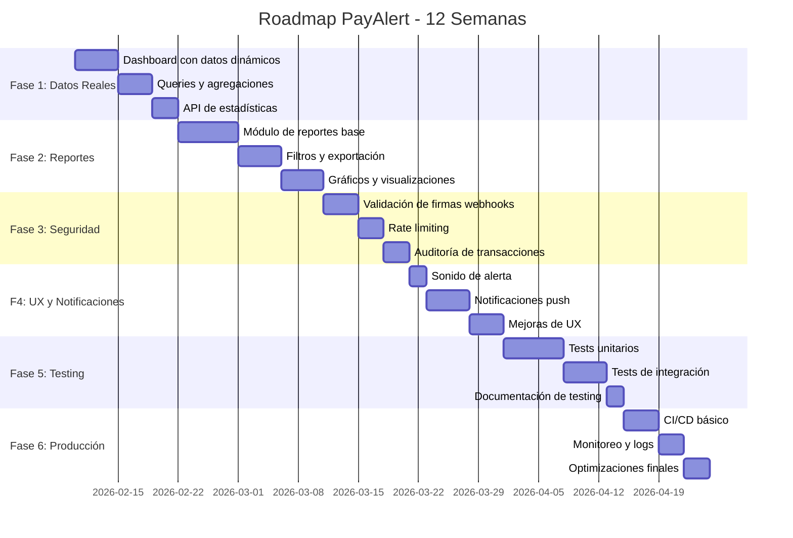

# 📋 Planificación de Desarrollo - PayAlert SaaS

**Fecha de creación:** 2026-02-06  
**Versión:** 1.0  
**Estado:** MVP Funcional - Fase de Consolidación

---

## 🎯 Resumen Ejecutivo

El proyecto PayAlert se encuentra en un estado **MVP funcional** con las funcionalidades core implementadas. Sin embargo, el sistema presenta limitaciones críticas que impiden su uso productivo, principalmente la **falta de reportes dinámicos** y datos reales en el dashboard.

### Estado Actual
- ✅ **Arquitectura base:** 95% completa
- ✅ **Autenticación y roles:** 100% completa
- ✅ **Gestión de datos (CRUD):** 90% completa
- ⚠️ **Visualización de datos:** 20% completa (dashboard estático)
- ❌ **Reportes y analytics:** 0% completa
- ❌ **Testing:** 5% completa

### Objetivos Principales
1. **Consolidar funcionalidades core** con datos reales
2. **Implementar sistema de reportes** para dueños
3. **Mejorar seguridad** de webhooks
4. **Optimizar UX** con notificaciones y feedback
5. **Preparar para producción** con testing y monitoreo

---

## 🗺️ Roadmap de Desarrollo



---

## 📊 Fase 1: Dashboard con Datos Reales (Semana 1-2)

**Objetivo:** Convertir el dashboard estático en una interfaz dinámica con datos reales de transacciones.

### Tareas Detalladas

#### 1.1 Backend - API de Estadísticas (3 días)
- [ ] **Task 1.1.1:** Crear API route `/api/stats/dashboard`
  - Endpoint: `GET /api/stats/dashboard`
  - Query params: `?storeId=&startDate=&endDate=`
  - Retorna: `{ income, expenses, balance, trends, storeBreakdown }`
  
- [ ] **Task 1.1.2:** Implementar queries de agregación en Supabase
  - Ingresos del día (suma de transactions tipo 'income')
  - Egresos del día (suma de transactions tipo 'expense')
  - Comparativa vs. día anterior
  - Top 5 transacciones recientes
  
- [ ] **Task 1.1.3:** Optimizar queries con índices
  - Índice compuesto: `(business_id, type, created_at)`
  - Índice para paginación: `(created_at DESC)`

#### 1.2 Frontend - Dashboard Owner (3 días)
- [ ] **Task 1.2.1:** Crear hook `useDashboardStats()`
  - Usar React Query para caching
  - Refetch automático cada 30 segundos
  - Manejo de estados (loading, error, success)

- [ ] **Task 1.2.2:** Actualizar componente `OwnerDashboard`
  - Reemplazar valores estáticos con datos del hook
  - Agregar indicadores de tendencia (↑ ↓)
  - Skeleton loaders mientras carga

- [ ] **Task 1.2.3:** Sección "Últimos Movimientos"
  - Tabla real con datos de transactions
  - Paginación (10 items por página)
  - Filtro por tipo (income/expense)

#### 1.3 Frontend - Dashboard Employee (2 días)
- [ ] **Task 1.3.1:** Mejorar terminal de cobros
  - Mostrar historial de pagos del día
  - Contador de pagos recibidos
  - Balance acumulado en sesión

- [ ] **Task 1.3.2:** Botón de "Registrar Gasto" rápido
  - Modal flotante desde el terminal
  - Campos: monto, descripción, categoría

### Entregables
- API de estadísticas funcional
- Dashboard owner con datos dinámicos
- Terminal mejorado para empleados

### Dependencias
- Esquema de BD existente ✅
- Supabase client ✅

---

## 📈 Fase 2: Sistema de Reportes (Semana 3-4)

**Objetivo:** Implementar un módulo completo de reportes financieros para dueños.

### Tareas Detalladas

#### 2.1 Backend - API de Reportes (4 días)
- [ ] **Task 2.1.1:** Endpoint `/api/reports/summary`
  - Reporte por período (diario, semanal, mensual, anual)
  - Agregaciones: totales, promedios, conteos
  - Agrupación por: tienda, categoría, método de pago

- [ ] **Task 2.1.2:** Endpoint `/api/reports/export`
  - Exportar a CSV
  - Exportar a Excel (xlsx)
  - Exportar a PDF

- [ ] **Task 2.1.3:** View de BD para reportes optimizados
  - Materialized view: `report_daily_summary`
  - Schedule: Refresco cada hora

#### 2.2 Frontend - Página de Reportes (5 días)
- [ ] **Task 2.2.1:** Layout base de reportes
  - Sidebar con filtros
  - Área principal con resultados
  - Header con acciones (exportar, imprimir)

- [ ] **Task 2.2.2:** Componente de filtros
  - Selector de fechas (rango)
  - Selector de tiendas (múltiple)
  - Selector de categorías
  - Tipo de transacción (income/expense/todas)

- [ ] **Task 2.2.3:** Tabla de resultados
  - Ordenamiento por columna
  - Paginación
  - Búsqueda en resultados

- [ ] **Task 2.2.4:** Gráficos y visualizaciones
  - Gráfico de líneas: evolución temporal
  - Gráfico de barras: comparativa por tienda
  - Gráfico circular: distribución por categoría
  - Librería sugerida: Recharts o Chart.js

- [ ] **Task 2.2.5:** Exportación
  - Botón "Exportar a Excel"
  - Botón "Exportar a PDF"
  - Descarga automática

#### 2.3 Reportes Pre-definidos (2 días)
- [ ] **Task 2.3.1:** Reporte "Flujo de Caja"
  - Ingresos vs Egresos por período
  - Balance acumulado
  - Exportable

- [ ] **Task 2.3.2:** Reporte "Ventas por Tienda"
  - Comparativa entre sucursales
  - Ranking de tiendas
  - Mapa de calor (opcional)

- [ ] **Task 2.3.3:** Reporte "Gastos por Categoría"
  - Desglose de egresos
  - Detección de anomalías
  - Tendencias

### Entregables
- Página de reportes completa
- 3 reportes pre-definidos funcionales
- Sistema de exportación (CSV, Excel, PDF)

### Dependencias
- Fase 1 completada
- Librería de gráficos (a instalar)

---

## 🔒 Fase 3: Seguridad y Robustez (Semana 5-6)

**Objetivo:** Asegurar los webhooks y proteger el sistema contra abusos.

### Tareas Detalladas

#### 3.1 Validación de Webhooks (3 días)
- [ ] **Task 3.1.1:** Implementar validación de firma Mercado Pago
  - Verificar `x-signature` header
  - Usar secret key para validación HMAC
  - Rechazar peticiones inválidas

- [ ] **Task 3.1.2:** Implementar validación de firma Ualá
  - Verificar signature según documentación
  - Manejar diferentes versiones de webhook

- [ ] **Task 3.1.3:** Mapeo de pagos a tiendas
  - Extraer `store_id` de `external_reference`
  - Crear lógica de fallback si no hay match
  - Log de errores de mapeo

#### 3.2 Rate Limiting y Protección (2 días)
- [ ] **Task 3.2.1:** Implementar rate limiting en API routes
  - Limitar webhooks: 100 requests/minuto por IP
  - Limitar API general: 1000 requests/hora por usuario
  - Usar Redis o memory-store

- [ ] **Task 3.2.2:** Protección contra IDOR
  - Verificar que usuario tenga acceso a recursos
  - Validar `business_id` en todas las queries
  - Tests de seguridad básicos

#### 3.3 Auditoría y Logs (3 días)
- [ ] **Task 3.3.1:** Tabla de auditoría
  - `audit_logs`: user_id, action, entity, entity_id, metadata, timestamp
  - Log automático en operaciones críticas

- [ ] **Task 3.3.2:** Log de webhooks
  - Tabla: `webhook_logs`
  - Guardar payload completo
  - Estado: received, processed, error
  - Reintentos automáticos

- [ ] **Task 3.3.3:** Sistema de alertas
  - Notificar errores críticos por email
  - Dashboard de monitoreo simple

### Entregables
- Webhooks seguros con validación de firmas
- Rate limiting implementado
- Sistema de auditoría funcionando

### Dependencias
- Acceso a credenciales de MP/Ualá
- Configuración de variables de entorno

---

## 🔔 Fase 4: UX y Notificaciones (Semana 7-8)

**Objetivo:** Mejorar la experiencia de usuario con feedback inmediato y notificaciones.

### Tareas Detalladas

#### 4.1 Sonido y Alertas Visuales (2 días)
- [ ] **Task 4.1.1:** Crear/bajar archivo de sonido
  - Archivo: `public/sounds/notification.mp3`
  - Sonido de caja registradora (till sound)
  - Formatos: MP3, OGG (fallback)

- [ ] **Task 4.1.2:** Implementar reproducción de sonido
  - Clase `AudioManager`
  - Manejo de permisos del navegador
  - Fallback silencioso si el usuario bloquea

- [ ] **Task 4.1.3:** Animaciones de alerta
  - Animación "ping" en pagos recibidos
  - Badge en ícono de app (si es PWA instalada)
  - Toast notifications con sonido

#### 4.2 Notificaciones Push (4 días)
- [ ] **Task 4.2.1:** Configurar Service Worker para push
  - Evento `push` en SW
  - Mostrar notificación nativa
  - Acciones: "Ver", "Cerrar"

- [ ] **Task 4.2.2:** Backend para envío de push
  - Integrar Web Push API
  - Guardar suscripciones en BD
  - Endpoint: `POST /api/notifications/send`

- [ ] **Task 4.2.3:** UI de preferencias
  - Configurar qué notificaciones recibir
  - Activar/desactivar sonido
  - Horario de silencio

- [ ] **Task 4.2.4:** Integrar con pagos
  - Enviar notificación al recibir pago
  - Notificación al superar umbral diario
  - Notificación de errores de webhook

#### 4.3 Mejoras de UX (3 días)
- [ ] **Task 4.3.1:** Optimistic updates
  - Actualizar UI inmediatamente al crear/editar
  - Rollback en caso de error
  - Feedback visual de sincronización

- [ ] **Task 4.3.2:** Empty states mejorados
  - Ilustraciones para páginas vacías
  - CTAs claros para primera acción
  - Guías contextuales

- [ ] **Task 4.3.3:** Loading states
  - Skeleton screens
  - Spinners contextuales
  - Progreso de carga en tablas

### Entregables
- Sistema de sonidos funcionando
- Notificaciones push implementadas
- Mejoras de UX aplicadas

### Dependencias
- Fase 1 completada
- Configuración VAPID keys para push

---

## 🧪 Fase 5: Testing (Semana 9-10)

**Objetivo:** Asegurar calidad del código con tests automatizados.

### Tareas Detalladas

#### 5.1 Tests Unitarios (5 días)
- [ ] **Task 5.1.1:** Configurar Jest + React Testing Library
  - Instalar dependencias
  - Configurar `jest.config.js`
  - Setup de testing environment

- [ ] **Task 5.1.2:** Tests de componentes UI
  - `BusinessCard` - renderizado y props
  - `DashboardStats` - cálculos
  - `ExpenseForm` - validaciones
  - Cobertura mínima: 70%

- [ ] **Task 5.1.3:** Tests de hooks
  - `useAuth` - estados de autenticación
  - `useDashboardStats` - fetching y caching
  - Mock de Supabase

- [ ] **Task 5.1.4:** Tests de utilidades
  - Formateo de moneda
  - Formateo de fechas
  - Validaciones

#### 5.2 Tests de Integración (3 días)
- [ ] **Task 5.2.1:** Tests de API routes
  - Webhooks: casos válidos e inválidos
  - Stats: filtros y agregaciones
  - Autenticación: protección de rutas

- [ ] **Task 5.2.2:** Tests de flujos de usuario
  - Login → Dashboard
  - Crear negocio → Crear tienda → Invitar empleado
  - Registrar gasto → Ver en reportes

- [ ] **Task 5.2.3:** Tests de base de datos
  - RLS policies (usando supabase-js)
  - Triggers y funciones
  - Constraints

#### 5.3 Tests E2E (2 días)
- [ ] **Task 5.3.1:** Configurar Playwright
  - Instalar y configurar
  - Scripts en `package.json`
  - GitHub Action para CI

- [ ] **Task 5.3.2:** Tests críticos
  - Autenticación completa
  - Flujo de onboarding (primer negocio)
  - Flujo de cobro (simulado)

#### 5.4 Documentación (1 día)
- [ ] **Task 5.4.1:** Guía de testing
  - Cómo ejecutar tests
  - Convenciones de nomenclatura
  - Mejores prácticas

### Entregables
- Suite de tests unitarios (70%+ cobertura)
- Tests de integración funcionando
- Tests E2E básicos configurados
- Documentación de testing

### Dependencias
- Jest, React Testing Library
- Playwright

---

## 🚀 Fase 6: Preparación para Producción (Semana 11-12)

**Objetivo:** Automatizar despliegues y monitorear el sistema en producción.

### Tareas Detalladas

#### 6.1 CI/CD Básico (3 días)
- [ ] **Task 6.1.1:** GitHub Actions workflow
  - Trigger: push a `main`
  - Jobs: lint → test → build → deploy
  - Configurar secrets (Vercel, Supabase)

- [ ] **Task 6.1.2:** Preview deployments
  - Deploy automático en PRs
  - URL de preview por PR
  - Tests en preview

- [ ] **Task 6.1.3:** Scripts de deployment
  - Script de migración de BD
  - Verificación de variables de entorno
  - Smoke tests post-deploy

#### 6.2 Monitoreo y Logging (2 días)
- [ ] **Task 6.2.1:** Integrar Sentry
  - Error tracking
  - Performance monitoring
  - Source maps

- [ ] **Task 6.2.2:** Dashboard de métricas
  - Requests por minuto
  - Errores 4xx/5xx
  - Latencia de API
  - Uso de BD

- [ ] **Task 6.2.3:** Alertas
  - Error rate > 1%
  - Latencia > 2s
  - BD connections > 80%
  - Integración con Slack/email

#### 6.3 Optimizaciones Finales (3 días)
- [ ] **Task 6.3.1:** Performance
  - Code splitting por ruta
  - Optimizar imágenes
  - Lazy loading de componentes
  - Bundle analyzer

- [ ] **Task 6.3.2:** SEO y Meta tags
  - Títulos descriptivos por página
  - Meta descriptions
  - Open Graph tags
  - Sitemap.xml

- [ ] **Task 6.3.3:** Accesibilidad
  - Audit con Lighthouse
  - Labels en formularios
  - Contraste de colores
  - Navegación por teclado

### Entregables
- Pipeline CI/CD funcionando
- Monitoreo con Sentry
- Dashboard de métricas
- Optimizaciones de performance aplicadas

### Dependencias
- Cuenta Vercel
- Cuenta Sentry
- Acceso a GitHub Actions

---

## 📋 Backlog y Mejoras Futuras

### Funcionalidades Post-MVP
- [ ] **Suscripciones y billing** - Cobro mensual por uso
- [ ] **Multi-moneda** - Soporte USD, EUR, etc.
- [ ] **API pública** - Para integraciones de terceros
- [ ] **Mobile app nativa** - React Native
- [ ] **Machine learning** - Predicción de flujo de caja
- [ ] **OCR** - Digitalización de comprobantes
- [ ] **Integración WhatsApp** - Notificaciones por WA
- [ ] **Multi-idioma** - Inglés, portugués

### Deuda Técnica
- [ ] Refactorizar queries complejas a stored procedures
- [ ] Migrar a TypeScript strict mode
- [ ] Implementar caching con Redis
- [ ] Separar webhooks en microservicios
- [ ] Implementar colas de procesamiento (Bull/Redis)

---

## 📊 Estimaciones y Recursos

### Estimación de Tiempo Total
- **Fase 1:** 2 semanas
- **Fase 2:** 2 semanas
- **Fase 3:** 2 semanas
- **Fase 4:** 2 semanas
- **Fase 5:** 2 semanas
- **Fase 6:** 2 semanas

**Total: 12 semanas (~3 meses)**

### Recursos Necesarios
- **Desarrollador Frontend/Fullstack:** 1 FTE
- **Supabase:** Plan gratuito (hasta cierto límite)
- **Vercel:** Plan gratuito (suficiente para MVP)
- **Sentry:** Plan gratuito (hasta 5k errores/mes)
- **Librerías adicionales:** ~$0 (open source)

### Dependencias Críticas
1. Acceso a credenciales de Mercado Pago (producción)
2. Acceso a credenciales de Ualá Bis (producción)
3. Dominio configurado para webhooks
4. SSL/HTTPS obligatorio para PWA

---

## 🎯 KPIs de Éxito

### Métricas Técnicas
- **Cobertura de tests:** > 70%
- **Performance (Lighthouse):** > 90
- **Uptime:** > 99.5%
- **Tiempo de respuesta API:** < 200ms (p95)

### Métricas de Negocio
- **Tiempo de onboarding:** < 5 minutos
- **Retención semanal:** > 40%
- **NPS:** > 50
- **Tickets de soporte:** < 5/mes por cliente

---

## ⚠️ Riesgos y Mitigaciones

| Riesgo | Probabilidad | Impacto | Mitigación |
|--------|-------------|---------|------------|
| Cambios en APIs de pago | Media | Alto | Monitorear changelogs, implementar adaptadores |
| Problemas de RLS en producción | Baja | Alto | Tests exhaustivos de políticas |
| Performance con muchos datos | Media | Medio | Implementar paginación y caching desde el inicio |
| Complejidad de notificaciones push | Alta | Medio | Usar librerías probadas (OneSignal como alternativa) |
| Tiempo de desarrollo excedido | Media | Medio | Priorizar features, MVP primero |

---

## 📝 Notas y Decisiones

### Decisiones Arquitectónicas Pendientes
1. **¿Usar React Query o SWR?** - Recomendación: React Query (más maduro)
2. **¿Gráficos con Recharts o Chart.js?** - Recomendación: Recharts (React-native)
3. **¿Exportación PDF con jsPDF o Puppeteer?** - Recomendación: jsPDF (más ligero)

### Stack Adicional Requerido
```json
{
  "dependencies": {
    "@tanstack/react-query": "^5.x",
    "recharts": "^2.x",
    "jspdf": "^2.x",
    "jspdf-autotable": "^3.x",
    "xlsx": "^0.18.x",
    "web-push": "^3.x"
  },
  "devDependencies": {
    "@testing-library/react": "^14.x",
    "@testing-library/jest-dom": "^6.x",
    "jest": "^29.x",
    "playwright": "^1.x"
  }
}
```

---

## ✅ Checklist de Aprobación

Antes de comenzar cada fase, verificar:
- [ ] Revisar código de fase anterior
- [ ] Actualizar documentación
- [ ] Verificar dependencias instaladas
- [ ] Revisar estimaciones vs. tiempo real
- [ ] Ajustar roadmap si es necesario

---

**Documento preparado por:** PayAlert Development Team  
**Última actualización:** 2026-02-06  
**Próxima revisión:** Al completar Fase 1

---

*"Planificar es preparar el camino, ejecutar es recorrerlo."*
